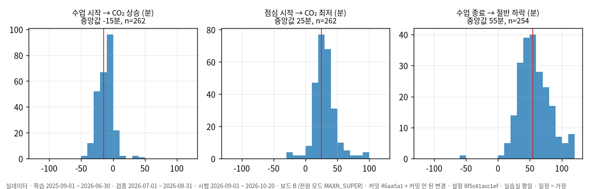
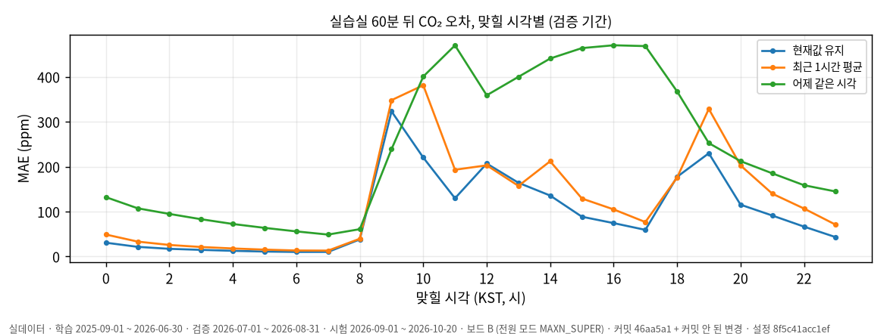

# 데이터 진단서 (D-1)

| 측정 조건 | 값 |
|---|---|
| 데이터 | 실데이터, InfluxDB `iot-bucket` 스냅샷(2026-10-21 내려받음, 원본 871만 행 → 정제 779만 행) |
| 기간 (KST) | 학습 2025-09-01 ~ 2026-06-30 · 검증 2026-07-01 ~ 2026-08-31 · **시험 2026-09-01 ~ 2026-10-20** |
| 보드 | 보드 B, 전원 모드 MAXN_SUPER · 설정 `config/prep.toml` · 재현: `python -m tsdata all` |

근거 수치 전체는 [diagnosis-data.md](diagnosis-data.md), 성능표는 [baseline.md](baseline.md)에 있다.

## 1. 정제 규칙

| 무엇 | 어떻게 | 왜 (이 데이터에서 본 것) |
|---|---|---|
| 불가능한 값 | CO₂ 300~10,000ppm, 온도 −30~50℃, 습도 0~100% 밖은 제거. 온도 −0.1은 오류값으로 제거 | CO₂ **65,535 1,069건**은 실습실 EM500 `2590` 한 대가 2026-07-04~06 사흘 동안 낸 고장값. 온도 −0.1과 습도 127.5는 같은 오류 프레임(402건 중 319건이 같은 시각 짝) |
| 대상 밖 기록 | 실습실·사무실·회의실·사무실 밖만 사용 | `창고` 85만 행, 공간 태그 없음 6.2만 행, `lab`·`강의실` 각 6행 |
| 짧은 결측 | **센서별로** 마지막 값을 최대 15분(3칸) 유지 | 과거 값만 쓰므로 서비스와 같은 계산이다. 처음에 쓴 선형 보간은 다음 관측을 끌어와 **입력에 미래가 섞였다**(누수) |
| 긴 결측 | 15분을 넘으면 비워 두고, 그 시각은 평가에서 빠짐 | 사무실 **2026-02 한 달 없음**, 2026-05는 모든 공간이 절반쯤 없음 |
| 다른 기록 주기 | 센서별 5분 평균 → 공간 **중앙값** | 1분(AM107 등)·2분(EM500)·10분(회의실 AM103, `1523`, `0101`)이 섞여 있다. 공간 단위로 메우면 칸마다 센서 구성이 바뀌어 대표값이 톱니처럼 뛰었다(실습실 5분 오차 59.6 > 30분 37.2). 센서별로 먼저 메우자 8.9 < 35.6으로 정상 |

**분석 간격 5분**: 예측 거리(5·15·30·60분)가 모두 5의 배수이고, 1분 센서의 잡음을 줄인다. 점심 뒤 최저까지 25분, 퇴실 뒤 절반까지 55분이 걸리므로(3절) 5분으로 모아도 변화를 놓치지 않는다.

**결측률(5분 칸 기준)**: 실습실 4.7%, 사무실 18.0%(2026-02), 사무실 밖 22.5%, 회의실 52.8%. 회의실은 센서가 10분마다 보내서 칸의 절반이 원래 비고, 15분 유지로 채우면 값이 있는 칸이 95.3%다. 평가 정답은 실제 관측 칸만 쓴다.

## 2. 분할 기준

학습 10개월 → 검증 2개월 → 시험 7주를 **시간 순서대로** 나눴고, 시험을 가장 최근으로 뒀다(지금 운영 환경과 가장 가깝다). 정규화 평균·표준편차는 학습 기간의 관측 칸만으로 계산해 `prep_params.json`에 저장했고, 검증·시험 값을 바꿔도 같은 값이 나오는 것을 테스트로 확인했다(AC-1).

**무작위로 섞으면 안 되는 이유**: CO₂는 1시간 뒤 값과의 상관이 0.91(실습실)이고, 5분 뒤 값은 사실상 같다. 섞으면 시험 시점 바로 앞뒤 5분이 학습에 들어가 모델이 "답을 옆에서 보고" 맞히게 되고, 운영(미래를 모름)보다 오차가 훨씬 작게 나온다.

## 3. 패턴과 일정–CO₂ 반응

- **실습실**: 08:45에 오르기 시작해 11시대 1,320ppm, 점심에 960ppm까지 내려갔다가 오후에 1,350ppm, 18시 이후 빠진다. 수업·점심·퇴실이 뚜렷하다. 주말은 500ppm 안팎에서 평평하다.
- **사무실**: 아침에 계단처럼 오른 뒤 하루 종일 천천히 올라 18시에 최고, 밤 늦게까지 천천히 빠진다. 사람 수는 적지만 머무는 시간이 길고 환기가 약하다(추정).
- **회의실**: 오전·오후 회의 덩어리가 보이고, 밤에는 16.5℃까지 식는다(난방 없음 추정).
- 온도도 사람을 따라 실습실·사무실에서 낮에 약 3℃ 오른다.

일정 자료(10/22 확인 대기) 대신 **가정 일정**(09:00 수업, 12:00~13:00 점심, 18:00 종료, 학습 기간 곡선에서 추정)으로 실습실 평일 297일을 분석했다.

| 반응 | 중앙값 | 해석 |
|---|---|---|
| 수업 시작 → CO₂ 상승(새벽 기준 +100ppm) | **−15분** | 수업 전에 사람이 먼저 온다. 일정 시각보다 CO₂가 먼저 움직인다 |
| 점심 시작 → CO₂ 최저 | **+25분** | 나가자마자 떨어지기 시작해 25분쯤 바닥 |
| 수업 종료 → 오후 수준의 절반까지 하락 | **+55분** | 사람이 나가도 1시간 가까이 남는다. 퇴실 직후 예측이 어려운 이유 |

**일정과 어긋난 날**(평소 반응보다 60분 넘게 다르거나 상승이 없는 평일):

- **상승 없음 = 공휴일**: 2025 추석(10/3~10/9), 1/1, 설(2/16~17), 5/1, 지방선거(6/3), 2026 추석(9/24~26), 10/5, 10/9. 9/23과 9/28~30도 상승이 없다(과정 사이 방학 추정, 확인 필요).
- **늦게 상승 = 휴일에 일부 사용**: 12/25(11:20), 2/18(16:25), 3/2 대체휴일(15:05), 5/5(17:45), 8/17 대체휴일(12:35).
- **늦은 퇴실**: 2025-11~12월에 20~23시까지 CO₂가 남은 날이 몰려 있다(22일). 야간 수업이나 자습 추정(확인 필요).

일정 자료를 받으면 `config/prep.toml`의 `[schedule]`만 바꿔 같은 분석을 다시 돌린다.

## 4. 기준선과 가장 강한 기준선 (AC-3)

시험 기간 60분 뒤 CO₂ MAE(ppm, 세 기준선이 같은 평가 시점):

| 공간 | 현재값 유지 | 최근 1시간 평균 | 어제 같은 시각 | 평가 시점 |
|---|---|---|---|---|
| 실습실 | **64.9** | 86.8 | 230.6 | 14,388 |
| 사무실 | **54.4** | 69.5 | 172.1 | 14,388 |
| 회의실 | **97.2** | 121.2 | 259.5 | 6,613 |

**현재값 유지가 공간·항목·거리·기간 48칸 모두에서 가장 강하다.** 이유:

1. **CO₂와 온도는 천천히 변한다.** 1시간 뒤 값과의 상관이 CO₂ 0.80~0.94, 온도 0.96~0.99로, 24시간 뒤 값과의 상관(CO₂ 0.45~0.58)보다 훨씬 높다. 하루 중 대부분(밤·수업 중간)은 1시간 동안 값이 거의 그대로다.
2. **최근 1시간 평균은 늦다.** 평균은 30분 전 수준을 대표하므로 오르거나 내리는 동안 항상 한 발 늦다. 평평할 때는 현재값과 같고, 변할 때는 더 틀린다.
3. **어제 같은 시각은 날마다 다른 것에 진다.** 주말·공휴일을 건너는 날에 크게 틀린다(검증 기간 실습실 월요일 358 vs 화요일 182). 평일끼리도 출석 인원·일정·환기가 달라 수준이 다르다.

**현재값 유지가 틀리는 곳**은 변화가 시작되는 시각이다: 실습실 60분 오차가 09시에 323ppm, 12시 207ppm, 19시 230ppm(새벽 10~30ppm). 09시에는 오히려 어제 같은 시각(239)이 낫다. 어제 값에는 "9시에 수업이 시작된다"는 정보가 있기 때문이다. → 과제 3 모델이 이겨야 할 곳은 바로 이 전환 시각이고, 시간대·요일·공휴일(일정) 정보가 필요하다.

**과제 3 목표선**(시험 60분 CO₂, 현재값 유지 × 0.7): 실습실 **45.4**, 사무실 **38.1**, 회의실 **68.0**ppm.

## 5. 생각해 볼 점

**'어제 같은 시각'이 가장 약한 이유, 어떤 공간이면 강할까?** 이 데이터의 하루는 같은 날이 반복되지 않는다. 주말·공휴일·휴일 사용·늦은 퇴실이 섞여 있고, 같은 평일이라도 인원이 다르다. 24시간 상관이 낮은(0.45~0.58) 것이 그 증거다. 반대로 **매일 같은 일과가 반복되고 사람 수가 일정한 공간**(고정 시간표 강의실, 타이머로 도는 냉난방 공간)이나 **사람과 무관하게 해를 따르는 값**에서는 강하다. 실제로 사무실 밖 온도는 24시간 상관이 0.977로, 하루 주기가 거의 그대로 반복된다. 또 "어제" 대신 "지난주 같은 요일"이나 "직전 평일"을 쓰면 월요일 문제가 줄어든다(과제 3에서 확인).

**고장이 섞인 구간은 학습에 넣어야 할까, 빼야 할까? 평가에서는?** **학습에서는 불가능한 값을 뺀다.** `2590`의 65,535 같은 값을 넣으면 모델이 고장을 "실제 공기"로 배운다. 다만 그 센서의 정상 값과 같은 공간의 다른 센서는 남겨 공간 대표값이 끊기지 않게 했다(중앙값이라 한 대가 빠져도 흔들림이 적다). **평가에서는 고장값을 정답으로 쓰지 않는다**(틀린 정답으로는 잴 수 없다). 그러나 공휴일·늦은 퇴실처럼 **실제로 일어난 드문 날은 빼지 않는다.** 운영에서도 일어나기 때문이다. 고장 자체를 잡는 것은 과제 4의 일이므로, 고장 구간 목록은 따로 남겨 과제 4의 정답 후보로 쓴다.

## 6. 그래서 무엇을 하나

- **과제 3 입력**: 최근 값(현재값 유지의 힘)에 시각·요일·공휴일 정보를 더해 전환 시각을 맞혀야 한다. 성능은 저장된 평가 시점(`eval_points.parquet`)에서만 비교한다.
- **시험 기간의 특징**: 시험 7주에 추석 연휴 등 상승 없는 평일이 8일 있다. 평평한 날은 현재값 유지가 쉽게 맞히므로, 모델 개선은 수업이 있는 날만 따로 봐야 드러난다.
- **회의실**: 10분 센서라 5분 뒤 정답은 절반 시각에만 있다. 60분 오차(97ppm)가 가장 크고, 회의 예약 정보가 가장 도움될 공간이다.
- **확인할 것(10/22)**: 일정 자료 출처, 9/28~30 상승 없음과 2025-11~12월 늦은 퇴실의 이유.
