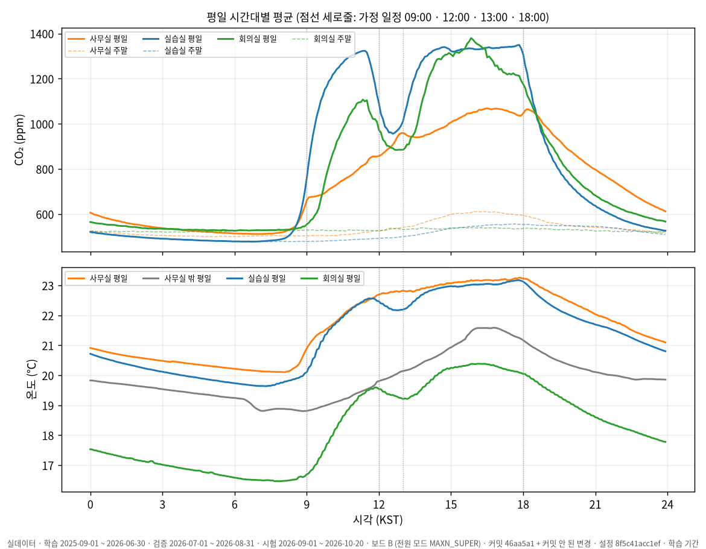

# 시계열 추론 과제 결과 보고서 (나영준, 007)

> 2026-10-23 갱신. 과제 1 브로커 재시작 시험(T029)까지 끝나 대기 항목이 없다.
> 범위: 과제 1~8 전부 수행(10/22 사용자 결정으로 과제 3~8을 다시 포함). 미통과·미측정 항목은 숫자와 이유를 그대로 적었다.

## 측정 조건 (모든 표 공통)

| 항목 | 값 |
|---|---|
| 데이터 | 실데이터. 과제 1 = 교육장 MQTT 브로커 실시간 수집(2026-10-21 16:04 KST~), 과제 2 = InfluxDB `iot-bucket` 스냅샷(2026-10-21) |
| 과제 2 기간 (KST) | 학습 2025-09-01 ~ 2026-06-30 · 검증 2026-07-01 ~ 08-31 · **시험 2026-09-01 ~ 10-20** |
| 보드 | Jetson Orin Nano Super 8GB 보드 B, JetPack 7.2.1, 전원 모드 MAXN_SUPER |
| 재현 | 저장소 커밋, `config/collector.toml`, `config/prep.toml`, `python -m tsdata all` |

## 과제 1. 데이터 수집 체계

**무엇을 만들었나**: MQTT 센서 메시지를 SQLite(WAL)에 저장하는 상시 수집기(`collector/`), systemd 서비스 `tsinfer-collector-yj`, 현황 조회 `status`와 보고서 `report` 명령.

| 확인 기준 | 결과 | 판정 |
|---|---|---|
| 브로커를 껐다 켜도 1분 안에 재개 | 로컬 브로커 재시작 3회 → 첫 행 4.8초씩. 실제 브로커 경로 120초 차단 해제 → 재연결 10.7초, 첫 행 20.8초 | 통과 |
| 재부팅 후 자동 재개 | 계획하지 않은 실제 재부팅 2번, 사람 개입 없이 부팅 → 첫 행 약 21초. 강제 종료 → 5초 뒤 재시작, 빠진 칸 0 | 통과 |
| 24시간 커버율 95%, 빠진 구간 원인 | 10-21 16:04 ~ 10-22 16:04: 1분 칸 98.3~98.8%(8개), 회의실 간격 기준 98.6%(3개). 빠진 구간 = 보드 멈춤 2번, 의도한 수집기 중지 1번, 회의실 무선 손실 3건. 수집기 오류 0 | 통과 |
| 산출물: 수집 현황 보고 | `report` 명령, [coverage-2026-10-22.md](001-data-collection/coverage-2026-10-22.md) | 통과 |
| 산출물: 형식 변경 대응 1건 | 키 이름 변경(`temperature`→`temp`) + 새 모델: 설정 7줄, 코드 변경 0줄 | 통과 |

**설계 핵심**
- 측정 시각 = 네트워크 서버 수신 시각(`nsTime`). 게이트웨이 한 대의 시계가 약 5분 빨라 원본 `time`은 쓰지 않았다.
- 중복: 같은 메시지가 경로만 달리해 약 4% 다시 온다. 기본키 `(센서, epoch, fCnt, 항목)` + `INSERT OR IGNORE`로 한 번만 저장.
- 끊김: 끊기면 1~10초 간격으로 스스로 다시 붙는다. 다만 **끊긴 동안의 메시지는 돌아오지 않는다**(120초 차단 시험에서 센서마다 2~4건 손실). QoS 1·지속 세션으로 받지만 발행 쪽이 QoS 0이라 브로커가 쌓아 두지 않는 것으로 보인다(추정). 메우려면 InfluxDB에서 되채운다.
- 결측 원인을 자동 분류: 수집기 중단 / 연결 끊김 / 수집기 쪽 손실 / 센서·무선 손실(fCnt 건너뜀) / 전송 간격 / 미상.

상세: [001-data-collection/README.md](001-data-collection/README.md), [fault-tests.md](001-data-collection/fault-tests.md), [format-change.md](001-data-collection/format-change.md)

## 과제 2. 데이터 이해와 기준선

| 확인 기준 | 결과 | 판정 |
|---|---|---|
| 정규화 값은 학습 기간 데이터로만 | 학습 기간 관측 칸만 사용, 검증·시험 값을 바꿔도 같음(테스트) | 통과 |
| 기준선과 이후 모델이 같은 시점·조건 | 평가 시점 목록을 파일로 고정, 정답은 실제 관측 칸만 | 통과 |
| 최강 기준선과 이유 | 현재값 유지가 48칸 모두 최강(아래) | 통과 |

**정제·분할**: CO₂ 300~10,000ppm 밖·온도 −0.1(오류 프레임)·습도 100% 초과 제거(센서 `2590`의 2026-07 고장값 65,535 1,069건 포함). 센서별 5분 평균 → 센서별 마지막 값 최대 15분 유지 → 공간 중앙값. 학습 10개월 → 검증 2개월 → 시험 7주, 시간순.

**기준선 성능 (시험 기간, 60분 뒤 CO₂ MAE, ppm)**

| 공간 | 현재값 유지 | 최근 1시간 평균 | 어제 같은 시각 |
|---|---|---|---|
| 실습실 | **64.9** | 86.8 | 230.6 |
| 사무실 | **54.4** | 69.5 | 172.1 |
| 회의실 | **97.2** | 121.2 | 259.5 |

**해석**
- CO₂는 1시간 뒤 값과의 상관(0.80~0.94)이 24시간 뒤(0.45~0.58)보다 훨씬 높아 현재값 유지가 강하다. 1시간 평균은 변화에 늦고, 어제 값은 주말·공휴일을 건너면 크게 틀린다(월요일 358 vs 화요일 182ppm).
- 현재값 유지는 수업 시작(실습실 9시 오차 323ppm)·점심·퇴실에 약하다. 9시에는 어제 같은 시각(239)이 오히려 낫다. 모델이 이겨야 할 곳은 이 전환 시각이고, 시간·요일·공휴일 정보가 필요하다.
- 평일에 CO₂가 오르지 않은 날은 거의 모두 공휴일이었다. 일정 자료를 받지 못해 일정은 CO₂ 곡선에서 추정했다(09:00 수업, 12:00~13:00 점심, 18:00 종료). 수업 시작 15분 전부터 오르고, 점심 25분 뒤 최저, 퇴실 55분 뒤 절반.

상세: [002-data-baseline/diagnosis.md](002-data-baseline/diagnosis.md), [baseline.md](002-data-baseline/baseline.md)

## 과제 3~8 요약

| 과제 | 확인 기준 | 결과 | 판정 |
|---|---|---|---|
| 3 60분 예측 | CO₂ 오차 현재값 유지보다 30% 이상 작게 | 실습실 −29%, 사무실 −22%, 회의실 −20% | **미통과** |
| | 온도가 현재값 유지보다 좋음 / 시험 기간 미사용 | 세 공간 모두 좋음 / 검증 기간으로만 선택 | 통과 |
| 4 이상 탐지 | 탐지율 80%, 헛경보 하루 1회 이하 | 80%(48/60), 하루 1.36회 | 탐지 통과(경계), **헛경보 미통과** |
| 5 상태 추정 | 사용 여부(직접 관찰 기준), 환기 경보 재현율 85%·규칙보다 macro-F1 | 직접 관찰 없음(일정 기준 F1 0.69 vs 규칙 0.50), 재현율 89.2%·0.638 > 0.624 | 사용 여부 **미충족**, 환기 통과 |
| 6 사전학습 모델 | 같은 시점, 4가지 근거 | Chronos-Bolt: GRU보다 덜 정확, 544ms·+320MB | 통과(채택 안 함) |
| 7 엣지 최적화 | 변환 후 CO₂ 1ppm·분류 0.1% 이하, 측정 조건 | ONNX Runtime 0.0003ppm·0%, GRU 0.12ms. TensorRT FP16 미측정 | 통과(TensorRT 제외) |
| 8 상시 서비스 | 12시간 무중단, 수집기 중지 경보, API, 형식 문서 | **14시간 10분·851/851주기**, 수집기 10분 중지 → 2분 18초 뒤 경보 → 재시작 1분 안에 복구, API 5종, 형식 문서 | 통과 |

**과제 3** ([상세](003-forecast-60min/README.md)): GRU가 이긴 곳은 규칙적인 변화(밤에 빠지는 CO₂, 등원·퇴실)다. 사람이 들고 나는 낮 시간은 현재값 유지와 거의 같았다. 일정 정보를 넣으면 실습실 60분 오차가 5.3ppm 줄었다. 사무실 0.1ppm, 회의실 1.1ppm으로, 수업 일정은 수업하는 방에만 맞는다. 검증 기간에는 실습실 −51%로 기준을 넘었다. 시험 기간에는 기준선이 더 잘 맞아 −29%에 그쳤다.

**과제 4** ([상세](004-anomaly/README.md)): 오토인코더 혼자는 60건 중 1건만 잡았다. 탐지도 헛경보(1.36회/일)도 전부 규칙에서 나왔다. 정상 범위 안에서 멈춘 값이나 몇 시간에 걸친 변화는 1시간 창 재구성으로 구별되지 않기 때문이다. 탐지율이 경계(80%)라 규칙을 그냥 느슨하게 하기는 어렵다(추정). 다음 단계는 공간별 임계값과 일정 정보(휴일·늦은 수업)를 규칙에 넣는 것이다.

**과제 5** ([상세](005-state/README.md)): 직접 관찰 기록이 없어 사용 여부는 일정 기반 정답으로만 평가했다. 환기 경보는 30분 전에 89%를 미리 잡았다.

**과제 6** ([상세](006-pretrained/README.md)): 학습 없이도 실습실에서는 GRU에 근접했다(45.2 vs 43.9). 불규칙한 사무실·회의실에서는 크게 뒤졌다. 새 공간 초기용으로만 가치가 있다.

**과제 7** ([상세](007-edge/README.md)): 작은 모델에서는 계산량보다 프레임워크 호출 비용이 지연을 정한다. PyTorch CPU 53ms → ONNX Runtime 0.12ms였고, GPU(0.8ms)가 오히려 느렸다. TensorRT 빌드를 다시 시도할 때 보드 메모리가 98%까지 차 재부팅됐다. 작업 메모리 상한과 시작 전 메모리 검사를 넣었다.

**과제 8** ([가동 기록](008-service/uptime.md), [결과 형식](008-service/result-format.md)): 주기 처리 시간은 평균 815ms, p95 914ms였다. 10/22 09:07에 서비스가 죽지 않고 멈췄는데, `Restart=always`는 이것을 잡지 못했다. systemd watchdog(5분)을 넣었다.

## 가장 의외였던 발견

**"빈칸을 앞뒤 값으로 메우는 것"이 미래를 몰래 보는 일이었다.** 결측을 선형 보간으로 메우면 뒤의 값을 끌어오므로, 예측 입력에 미래가 섞인다. 거기에 센서 간격이 섞인 방에서는 칸마다 대표값을 만든 센서가 바뀌어 "5분 뒤 오차가 30분 뒤 오차보다 크다"는 말이 안 되는 숫자가 나왔다. 센서별로 과거 값만으로 메우자 둘 다 해결됐다. 서비스가 그 시각에 계산할 수 없는 전처리는 쓰면 안 된다.

## 5분 발표 메모

1. (30초) 무엇을: 교육장 CO₂·온도 센서, 1년치 + 실시간 수집.
2. (1분) 과제 1: 끊기지 않는 수집 — 중복 4%, 시계 5분 오차, 강제 종료 손실 0, 24시간 커버율 98% 이상(빠진 시간은 수집기가 아니라 보드가 멈춘 것).
3. (1분 30초) 과제 2: 현재값 유지가 최강(그래프), 그러나 9시·점심·퇴실에 약함(시간대별 오차 그래프).
4. (1분 30초) 가장 의외였던 발견: 보간이 누수였다 → 톱니 숫자로 알아챔.
5. (30초) 배운 것: 단순한 기준선을 먼저 재고, 이상한 숫자는 버그의 단서다.
